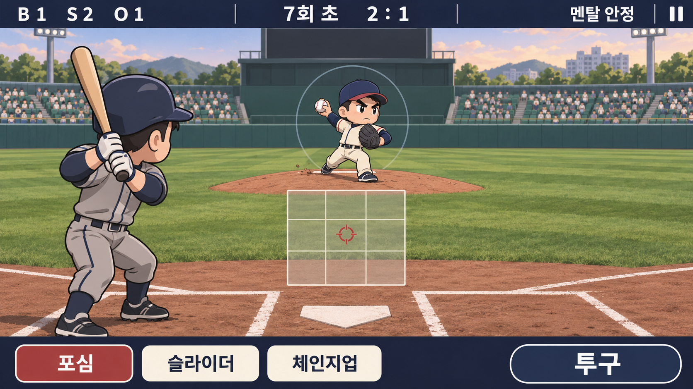
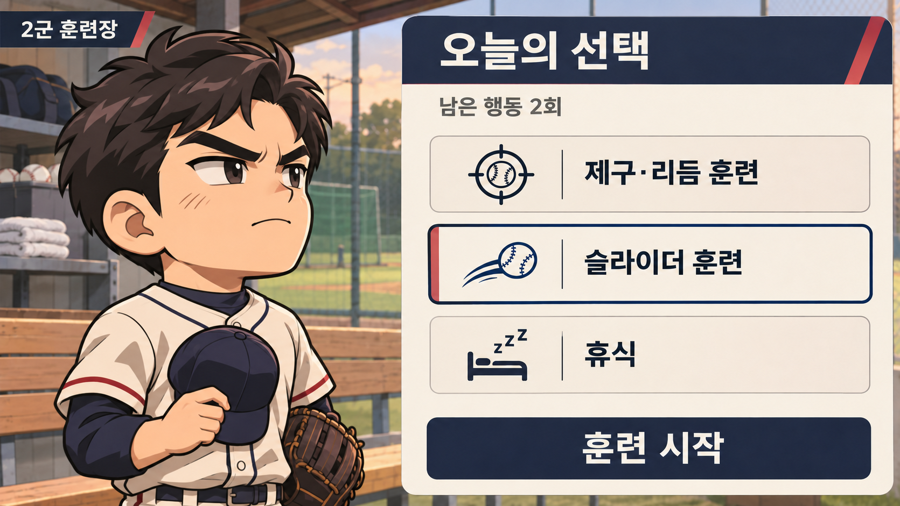

# 야구 투수 육성 게임

## 프로젝트 소개

방출 위기에 놓인 프로 투수의 모든 공을 직접 던지고, 훈련과 재도전을 통해 커리어를 이어가는 모바일 게임을 개발하고 있습니다.

직접 투구 액션과 선수 육성을 결합한 1인 개발 프로젝트입니다. 플레이어의 조작 실력과 선수의 성장이 함께 작용해, 과거에 무너졌던 위기를 다시 극복하는 경험을 목표로 합니다.

> 아래는 기획을 바탕으로 AI로 만든 예상 이미지입니다. 실제 게임 화면이 아니며, 캐릭터 외형·UI·표시 수치는 예시입니다.

| 직접 투구 | 훈련·성장 선택 |
| :---: | :---: |
|  |  |

## 주요 특징

현재 설계에서 목표로 하는 주요 특징입니다.

- **직접 투구**: 구종과 목표 코스를 선택하고, 릴리스 타이밍을 맞춰 모든 공을 직접 던집니다.
- **선수 성장**: 훈련·휴식과 퀘스트를 통해 투구 능력을 발전시키고 다음 등판을 준비합니다.
- **커리어와 재도전**: 첫 1군 실패와 2군 생활을 거쳐, 평가 등판의 결과에 따라 1군 재도전과 커리어의 향방이 달라집니다.
- **팬과 커뮤니티 반응**: 실제 경기 사건에 맞춰 미리 작성한 기사·게시글·댓글을 선택해 보여줍니다.

## 기술 및 관련 문서

- **엔진·언어**: LÖVE · Lua
- **목표 플랫폼**: Android · 가로 화면 · 터치 조작
- **플레이 방식**: 오프라인 싱글플레이

상세 기획은 [게임 디자인 문서 안내](docs/game_design/INDEX.md)에서 확인할 수 있습니다. [기술 설계](docs/game_design/09_technical_architecture_and_data.md)와 [검증 현황](docs/game_design/VALIDATION_MATRIX.md)도 함께 관리합니다.
